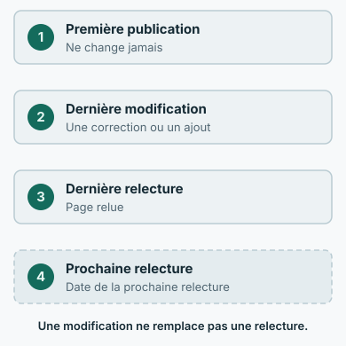
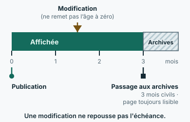
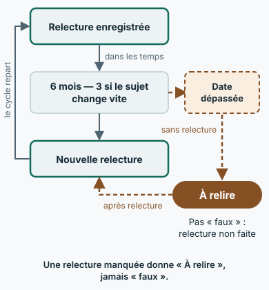

# Comment vieillissent ces notes

Une page a quatre dates. Chacune répond à une question différente.

- **Première publication** : le jour de la mise en ligne. Elle ne change jamais.
- **Dernière modification** : le jour d'une correction ou d'un ajout.
- **Dernière relecture** : le jour où la page a été relue.
- **Prochaine relecture** : la date prévue de la prochaine relecture.

Une modification ne vaut pas une relecture. Corriger une faute ne prouve pas que le fond est encore exact.

## Une actualité a une durée de vie

Une actualité décrit un fait à une date donnée. Elle reste affichée trois mois civils après sa première publication. Ensuite, elle passe aux archives. La page reste lisible. Le site l'étiquette alors « Actualité ancienne » et la retire de la liste courante ; les archives restent accessibles.

Modifier l'actualité ne repousse pas cette échéance. Un fait vraiment nouveau reçoit sa propre page datée, avec un lien vers la première.

## Un guide se relit

Un guide reste utile plus longtemps. Il est donc relu :

- tous les six mois par défaut ;
- tous les trois mois si le sujet change vite.

Si la date passe sans relecture enregistrée, la page affiche « À relire ». Cela ne veut pas dire « faux ». Cela veut dire : la relecture prévue n'a pas eu lieu. Une erreur connue, elle, est corrigée ou signalée tout de suite.

## Une expérience garde son contexte

Une expérience décrit un seul essai. Elle indique la date du test, les versions des produits, la méthode, les résultats et les limites. Un résultat daté ne garantit rien pour une version plus récente.

## Les étiquettes que vous verrez (exemples)

Les dates ci-dessous sont des exemples inventés.

- **À jour · prochaine relecture septembre 2027** : le guide a été relu. Le mois indiqué est celui de la prochaine relecture.
- **À relire** : la date de relecture est passée sans relecture enregistrée. Lisez avec prudence.
- **Actualité ancienne** : l'actualité a plus de trois mois. Elle est aux archives et n'est plus dans la liste courante.
- **Expérience · testée le 12 mars 2026** : résultat d'un test précis, à cette date. Il n'est pas relu ensuite.
