# MoE : comment un token choisit ses experts

## L'essentiel

- Dans un modèle MoE (mixture-of-experts), chaque couche contient plusieurs experts. Un token n'en utilise que quelques-uns.
- Un petit router choisit les experts, token par token et couche par couche.
- Le modèle a beaucoup de paramètres au total, mais peu d'active parameters par token.
- Un système peut garder les experts les plus utilisés en mémoire rapide et lire les autres sur SSD. La vitesse dépend alors du hit rate.

## Un router, des experts, un mélange

Dans une couche MoE, le router donne un score à chaque expert pour le token en cours. On garde les k meilleurs (le top-k). Seuls ces experts calculent. Leurs sorties sont mélangées avec des poids de mélange tirés des scores. Mixtral a 8 experts par couche et en choisit 2 ([Jiang et al.](https://arxiv.org/abs/2401.04088)). Switch Transformers simplifie le routage et garde un coût de calcul constant avec un nombre de paramètres croissant ([Fedus et al.](https://arxiv.org/abs/2101.03961)).

Source de la figure : [Jiang et al.](https://arxiv.org/abs/2401.04088) (8 experts, 2 choisis).

Ce choix est appris à l'entraînement. Personne ne l'écrit à la main. Un expert n'est pas un spécialiste d'un sujet : c'est un bloc de calcul appris. Rien ne garantit qu'un expert « fasse le code » ou « fasse les maths ».

## Beaucoup de paramètres, peu utilisés

Chaque token n'active qu'une partie du modèle. Mixtral compte 47 milliards de paramètres au total et en utilise 13 milliards par token. DeepSeek-V3 en compte 671 milliards et en utilise 37 milliards ([DeepSeek-AI](https://arxiv.org/abs/2412.19437)).

Sources de la figure : [Jiang et al.](https://arxiv.org/abs/2401.04088) ; [DeepSeek-AI](https://arxiv.org/abs/2412.19437).

Le calcul par token ressemble donc à celui d'un modèle bien plus petit. En revanche, tous les experts doivent rester accessibles : le modèle garde la taille mémoire de son total.

## Un choix par token et par couche

Le router décide à chaque couche et pour chaque token. Une réponse contient donc de très nombreuses décisions. Selon la description de Colibri, certains experts reviennent plus souvent que d'autres selon l'usage. Pour éviter que quelques experts reçoivent presque tous les tokens, l'entraînement applique un load balancing. DeepSeek-V3 présente une méthode de load balancing sans auxiliary loss (terme de perte ajouté à l'entraînement).

Exemple inventé ; l'idée de réutilisation vient de la description de [Colibri](https://github.com/JustVugg/colibri).

## Où vivent les experts

Si certains experts reviennent plus que d'autres, comme le décrit Colibri, on peut les garder en mémoire rapide et lire les autres à la demande. Un hit est un expert déjà en mémoire. Un miss oblige à une lecture sur SSD, plus lente. Plus le hit rate est haut, plus le décodage va vite. Aucun chiffre général n'est donné ici : tout dépend du modèle, de la machine et de la charge.

Source de la figure : [projet Colibri](https://github.com/JustVugg/colibri) (principe, tel que le projet le décrit).

## Un exemple daté : Colibri

Colibri est un moteur open source qui applique ce principe : experts chauds sur GPU, tièdes en RAM, froids lus sur NVMe, selon son README consulté le 2026-11-26. Le projet indique avoir mesuré +37,5 % de decoding avec deux disques NVMe sur des contrôleurs indépendants (lecture en miroir). C'est une mesure rapportée par le projet, pour une seule configuration. Le projet évolue vite : ce chiffre vieillira vite. Citer Colibri n'est pas une recommandation.

## Limites

Cette page décrit le mécanisme. Elle ne dit pas qu'on peut faire tourner un très gros modèle à bonne vitesse sur un portable : la lecture sur SSD limite la vitesse. Les nombres ci-dessus viennent des articles cités et ne valent que pour leurs modèles.

## Sources

- Jiang et al., Mixtral of Experts (2024) : https://arxiv.org/abs/2401.04088
- Fedus et al., Switch Transformers (2021) : https://arxiv.org/abs/2101.03961
- DeepSeek-AI, DeepSeek-V3 Technical Report (2024) : https://arxiv.org/abs/2412.19437
- Colibri, README du projet (consulté le 2026-11-26) : https://github.com/JustVugg/colibri
