# Quantization: how a model fits in less memory

Quantization stores each model weight with fewer bits. The file and the memory needed to hold the weights shrink. The cost is some precision, and sometimes some quality. A "4-bit" model really uses a little more than 4 bits per weight, because it must also store a shared scale for each small group of weights.

This page covers storage and memory for the weights only. It does not cover speed.

## A model is a very large table of numbers

A language model is mostly a table of numbers. Each number is a **weight**. A model with 7 billion weights has 7 billion numbers in that table.

A common format stores each weight in 16 bits. A **bit** is one binary digit. 16 bits take 2 bytes. So 7 billion weights take 14 billion bytes, about 14 GB. Here 1 GB means 10⁹ bytes. The arithmetic is 7 × 10⁹ weights × 16 bits ÷ 8 bits per byte.

**Quantization** means storing each weight with fewer bits. At 8 bits, the same table takes 7 GB. At 4 bits, it takes 3.5 GB.

Two public papers report that this works in their tests. The LLM.int8() paper reports that its method cuts the memory needed for inference by half, for the feed-forward and attention projection layers. **Inference** means running a trained model to get answers. The paper reports that its models kept full-precision performance ([Dettmers et al., 2022](https://arxiv.org/abs/2208.07339)). The GPTQ paper reduces weights to 3 or 4 bits and reports negligible accuracy loss ([Frantar et al., 2022](https://arxiv.org/abs/2210.17323)). Both results hold for the models and measures those papers used. Do not read them as a guarantee for every model.

## How weights become small integers

A 4-bit slot holds only 16 values. Real weights are decimal numbers such as 0.12 or -0.80. So the method turns each weight into a small whole number and keeps a way to rebuild an approximate decimal value.

The method splits the weights into small **groups**. Each group gets one **scale**, a single decimal number shared by all weights in the group. The method divides each weight by the scale and rounds the result to a whole number. It stores that whole number. This is **quantizing**.

To use the weight later, the program multiplies the stored whole number by the scale. This is **dequantizing**. The result is close to the original, but not equal to it. Rounding discards information, so quantization is lossy.

Block-wise quantization with a scale per block is how the llama.cpp source code lays out its formats ([ggml-common.h](https://github.com/ggml-org/llama.cpp/blob/master/ggml/src/ggml-common.h)). Transformers, the Hugging Face library, can dequantize a model, either at load time or afterwards ([Hugging Face Transformers, "Dequantize a model"](https://huggingface.co/docs/transformers/main/en/quantization/dequantize)). Other tools may dequantize during computation. This page does not claim which.

### A worked example

Take one group of eight weights. The weights are invented numbers for teaching, not taken from any real model. To keep the arithmetic simple, the scale is the largest absolute value divided by 7. The stored whole numbers run from -8 to 7, the range of a 4-bit signed integer. Real schemes differ in detail.

The weights are 0.12, -0.80, 0.33, 0.05, -0.41, 0.64, -0.22 and 0.27. The largest absolute value is 0.80. The scale is 0.80 ÷ 7, about 0.1143. The stored whole numbers are 1, -7, 3, 0, -4, 6, -2 and 2. Restored, they are about 0.11, -0.80, 0.34, 0.00, -0.46, 0.69, -0.23 and 0.23.

The small weights suffer. The weight 0.05 divided by 0.1143 is 0.44, which rounds to 0. It is restored as 0.00, an error of 0.05. This is the largest error in the group.

Now split the same eight weights into two groups of four. The first group is 0.12, -0.80, 0.33 and 0.05. Its largest absolute value is still 0.80, so nothing changes there. The second group is -0.41, 0.64, -0.22 and 0.27. Its largest absolute value is 0.64, so its scale is about 0.0914. The weight 0.64 is now restored exactly. The weight 0.27 is restored as about 0.274, an error of 0.004 instead of 0.041. The weight -0.22 gets worse. It is restored as about -0.183, an error of 0.037 instead of 0.009. In the second group, the total error size falls from about 0.143 to about 0.086.

The lesson: one large weight in a group stretches the scale and makes the small weights less accurate. Smaller groups follow local sizes more closely. This is one hand-picked example. Only the second group improved, and not every weight in it did. It is arithmetic on invented numbers, not a measured result on a real model.

## "4-bit" costs more than 4 bits

Every group also stores its scale. Suppose a group has 64 weights, each stored in 4 bits, and one 16-bit scale. The cost per weight is 4 + 16 ÷ 64 = 4.25 bits. If the group also stores a 16-bit zero-point, an offset that shifts the range, the cost is 4 + 32 ÷ 64 = 4.5 bits.

The small group in the figure costs more. Its 8 weights take 8 × 4 + 16 = 48 bits, which is 6 bits per weight. With 8 weights per group the scale costs 2 bits per weight. With 64 it costs 0.25 bit.

The llama.cpp format called Q4_K also uses about 4.5 bits per weight, but with a different layout. It groups 256 weights into a super-block of 8 blocks of 32 weights. Each block has its own scale and offset, stored with 6 bits each. The super-block adds two 16-bit values. That gives (2 × 16 + 12 × 8 + 128 × 8) ÷ 256 = 4.5 bits per weight ([ggml-common.h](https://github.com/ggml-org/llama.cpp/blob/master/ggml/src/ggml-common.h)). The exact layout varies by tool, so check the format you use.

Group size sets a trade-off. A group of 32 weights costs 4 + 16 ÷ 32 = 4.5 bits per weight. A group of 128 costs 4.125 bits. Smaller groups cost more scale storage and, as the example above shows, can follow the weights more closely.

Here is the size of a 7-billion-weight model, for the weights only:

| Storage per weight | Arithmetic | Size |
|---|---|---|
| 16 bits | 7 × 10⁹ × 16 ÷ 8 | 14 GB |
| 8 bits | 7 × 10⁹ × 8 ÷ 8 | 7 GB |
| 4.25 bits (group of 64, one 16-bit scale) | 7 × 10⁹ × 4.25 ÷ 8 | about 3.7 GB |

A running model needs more memory than its weights. This page does not size that extra memory.

## What quantization costs in quality

Rounding adds error. Research shows the damage is uneven. The LLM.int8() authors found a few features with very large values. Their method keeps those features in 16 bits. More than 99.9% of values are still multiplied in 8 bits ([Dettmers et al., 2022](https://arxiv.org/abs/2208.07339)). The AWQ paper reports that protecting only 1% of salient weights greatly reduces quantization error ([Lin et al., 2023](https://arxiv.org/abs/2306.00978)). Those are results from the papers' own tests.

Methods differ in how they choose what to protect. Simple rounding treats all weights alike. GPTQ uses approximate second-order information to choose its rounding. That means it estimates how much the model's error changes when each weight changes ([Frantar et al., 2022](https://arxiv.org/abs/2210.17323)). AWQ measures the values the model computes on sample inputs, offline. It uses those measurements to find which weight channels matter most ([Lin et al., 2023](https://arxiv.org/abs/2306.00978)).

## How to judge a quantized model

Do not trust the bit count alone. Run your own task on the original and the quantized model. Use questions with known answers. Compare quality, not only file size. Record the model, the format, the group size and the date, because a result is valid only for its setup.

## Limits of this page

The examples are illustrations on invented numbers, not measurements. This page does not report a test of any tool. It does not cover speed, and it does not describe any specific product's file format beyond the Q4_K size above.

## Sources

All sources accessed 2026-11-25. The AWQ abstract was read at its current arXiv version (v6, updated 2026-04-25); the paper was first posted in 2023.

- Dettmers et al., "LLM.int8()", 2022: https://arxiv.org/abs/2208.07339
- Frantar et al., "GPTQ", 2022: https://arxiv.org/abs/2210.17323
- Lin et al., "AWQ", 2023: https://arxiv.org/abs/2306.00978
- llama.cpp source, `ggml/src/ggml-common.h` (block layouts, including `block_q4_K`): https://github.com/ggml-org/llama.cpp/blob/master/ggml/src/ggml-common.h
- Hugging Face Transformers, "Dequantize a model": https://huggingface.co/docs/transformers/main/en/quantization/dequantize
